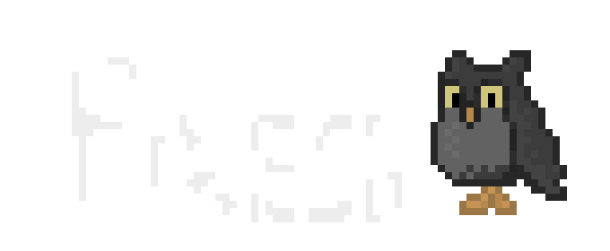
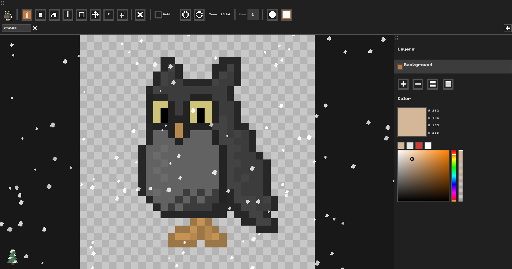
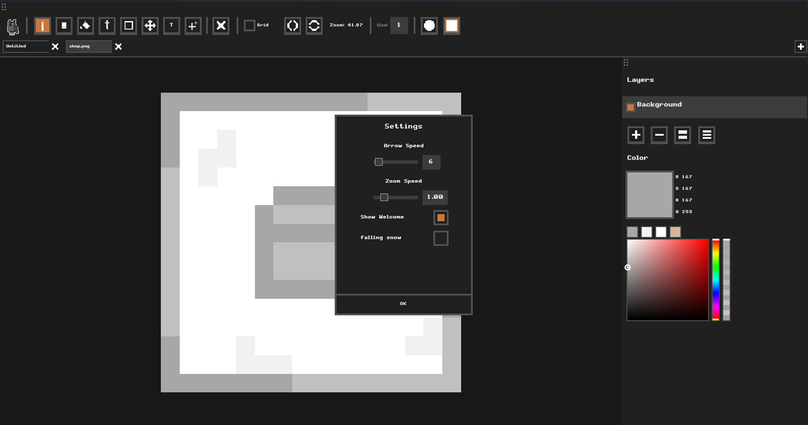

# Pixesh



A minimal pixel art editor built with Rust and egui.

<p align="center">
  
  
</p>

## Install

Version 0.1.0 — grab an installer from the
[releases page](https://github.com/EnotCoder/pixesh/releases/latest):

| Platform | File | What it does |
|----------|------|--------------|
| Linux x86-64 | `Pixesh-0.1.0-x86_64.AppImage` | `chmod +x` and run it — no installation needed |
| Linux x86-64 | `pixesh-0.1.0-linux-x86_64.tar.gz` | Unpack and run `./install.sh` (installs into `~/.local`, no root needed) |
| Windows x86-64 | `pixesh-0.1.0-setup.exe` | Regular installer: Start Menu shortcut, PNG association, optional PATH entry and uninstaller |

Icons and the font are embedded in the binary. On Linux you need **GTK 3** at
runtime, and only for the file dialogs: `sudo apt install libgtk-3-0`. The Linux
binaries are built on Ubuntu 22.04, so they work with glibc 2.35 and newer.

Once installed, Pixesh is a normal command:

```bash
pixesh              # empty canvas
pixesh drawing.png  # open one or more images in tabs
pixesh --version
```

## Features

- **Tools** — Brush, Eraser, Fill, Eyedropper, Select, Move, Text, Transform,
  with round or square brush shapes
- **Effects** — 17 effects ported from
  [Pixelorama](https://github.com/Orama-Interactive/Pixelorama), with a live
  preview; see [Effects](#effects)
- **Animation** — add, duplicate and reorder frames, play-pause with an FPS
  setting, per-layer cels
- **Layers** — add, remove, duplicate, flatten, rename, per-layer visibility
- **Selection** — rectangular marquee, copy/paste, delete, crop the canvas to
  the selection
- **Editing** — resize or scale the canvas with an optional aspect-ratio lock,
  text tool, mirror, grid overlay, HSV picker, live RGB/hex entry (`Ctrl+K`),
  zoom and pan, zoom-to-fit
- **Rearrangeable layout** — drag panels between window edges, resize them,
  hide them; the arrangement and your settings come back on the next launch
- **Files** — open with `Ctrl+O` or by dropping files onto the window (each
  becomes its own tab), multi-document tabs, PNG export with scale, background
  and sprite-sheet options
- **History** — undo / redo, up to 50 steps
- **Settings** — arrow-pan speed, zoom speed, falling snow and whether the
  welcome window appears at startup
- **Lua config** — remap every shortcut, change theme colours, the 1–9 palette
  and layout/tool constants in a plain text file, reload with `Ctrl+Shift+R`

## Controls

| Key | Action |
|-----|--------|
| `B` `E` `F` | Brush, Eraser, Fill |
| `R` `M` `T` | Select, Move, Text |
| `Shift+X` | Transform (needs a selection) |
| `X` | Clear all layers (asks for Yes/No confirmation) |
| `Alt` (hold) | Eyedropper |
| `Right-click + drag` | Eraser |
| `W` `S` | Brighten / darken the colour |
| `A` `D` | Less / more saturated |
| `I` `K` | Hue back / forward |
| `,` `.` | Decrease / increase opacity |
| `Ctrl+C` `Ctrl+V` | Copy / paste selection across tabs — `Y` and `P` do the same |
| `Ctrl+A` | Select the whole canvas |
| `1`–`9` | Preset colour — red, green, blue, yellow, cyan, magenta, white, gray, black |
| `Enter` | Commit pasted pixels, otherwise crop to the selection |
| `Delete` / `Escape` | Delete selection / cancel paste, deselect, close dialogs |
| `[` `]` `Space` | Previous / next frame, play-pause |
| `Scroll` / `Shift+Scroll` | Zoom / brush size |
| `Ctrl++` / `Ctrl+-` | Increase / decrease brush size by 1 |
| `Arrows`, `Shift+Arrows` | Pan canvas (`Shift` = 4x speed) |
| `Middle mouse drag` | Pan canvas |
| `Ctrl+S` / `Ctrl+O` | Export PNG / open image in a new tab |
| `Ctrl+R` / `Ctrl+I` | Resize / scale canvas |
| `Ctrl+L` / `Ctrl+Shift+L` | Add / remove layer immediately (no paste or transform commit) |
| `Ctrl+W` | Panels dialog — show, hide and arrange panels; `↑`/`↓` select, `Enter` toggle, `Esc` close |
| `Ctrl+Shift+E` | Effects panel |
| `Ctrl+Shift+F` | Flatten layers |
| `Ctrl+H` | Settings dialog |
| `Ctrl+N` / `Ctrl+D` | New blank tab / close the active tab (like the tab bar `+` and `×`) |
| `Ctrl+Shift+D` | Deselect |
| `Ctrl+K` | Enter a colour live from the keyboard: `r,g,b[,a]` or `#RRGGBB[AA]`; `Enter`/`Esc` close. No undo/history entry |
| `Ctrl+Tab` | Next tab |
| `Ctrl+Z` / `Ctrl+Shift+Z` | Undo / redo |
| `Ctrl+Shift+R` | Reload the Lua config |
| `G` | Toggle grid |

All shortcuts above are defaults from `config/config.lua`; see [Configuration](#configuration).

## Effects

`Ctrl+Shift+E` (or the sparkle button) opens the panel. Effects respect the
active selection, preview live while you drag a slider, and can be applied to
every layer or every frame. Nothing enters the undo history unless pixels
actually change.

| Category | Effects |
|----------|---------|
| **Transform** | Offset & Scale, Mirror Image, Rotate Image, Flat to Isometric |
| **Color** | Invert Colors, Desaturation, Adjust Hue/Sat/Value, Adjust Brightness/Contrast, Color Curves, Palettize, Posterize, Gradient Map |
| **Procedural** | Outline, Drop Shadow, Gradient |
| **Blur** | Pixelize, Gaussian Blur |

Ported from Pixelorama; the GLSL shaders are reimplemented as plain CPU code,
so they behave identically everywhere. Two are deliberately not identical to
the originals: **Palettize** builds its palette from the image itself (median
cut), and **Color Curves** is a per-channel gamma plus black/white points
rather than an interactive curve editor.

## Layout

Drag a panel by the small grip at its start onto another window edge — the
eligible edges light up while you drag. Toolbar, status bar and timeline move
only between top and bottom, the layers panel only between left and right,
since they are shaped differently. Drag a panel's *outer* edge to resize it.

Everything is kept in one file — `~/.local/share/pixesh/app.ron` on Linux,
`%APPDATA%\pixesh\data\app.ron` on Windows — written every 10 seconds and on
exit. Dialogs are never restored, so nothing opens by itself.

## Configuration

On the first launch Pixesh copies the documented default config to
`~/.config/pixesh/config.lua` (`$XDG_CONFIG_HOME/pixesh/config.lua` if set).
Use `pixesh --config /path/to/file.lua` to load a different file. It is a Lua
5.4 file with three optional tables:

```lua
colors = { accent = "#c8783c", palette = { "#ff0000", ... } }
constants = { font_size = 20, max_side = 4096, hsv_step = 5 }
keys = { undo = "Ctrl+Z", copy = { "Y", "C" }, redo = false }
```

An action set to `false` removes its default binding.

`Ctrl+Shift+R` re-reads the file without restarting; parse errors are shown in
the status bar and leave the last good config in place. Every action name,
colour, constant and key syntax is documented in [docs/CONFIG.md](docs/CONFIG.md)
and in the generated file itself.

## Build

```bash
cargo build --release
./target/release/pixesh
```

Windows can be cross-compiled from Linux:

```bash
rustup target add x86_64-pc-windows-gnu
CARGO_TARGET_X86_64_PC_WINDOWS_GNU_LINKER=x86_64-w64-mingw32-gcc \
    cargo build --release --target x86_64-pc-windows-gnu
```

Packaging (the release workflow in `.github/workflows/release.yml` does exactly
this on a `v*` tag):

```bash
# Linux: install.sh tarball + AppImage in dist/
cargo build --release
bash scripts/package-linux.sh

# Windows: needs Inno Setup (iscc, or wine + WINE_ISCC=...)
cargo build --release --target x86_64-pc-windows-gnu
bash scripts/package-windows.sh dist target/x86_64-pc-windows-gnu/release/pixesh.exe
```

## Documentation

- [docs/ARCHITECTURE.md](docs/ARCHITECTURE.md) — project structure, data model,
  editing pipeline, effects, persistence and performance notes
- [docs/UI_COMPONENTS.md](docs/UI_COMPONENTS.md) — theme, shared widgets,
  panels, dialogs and keyboard/mouse shortcuts