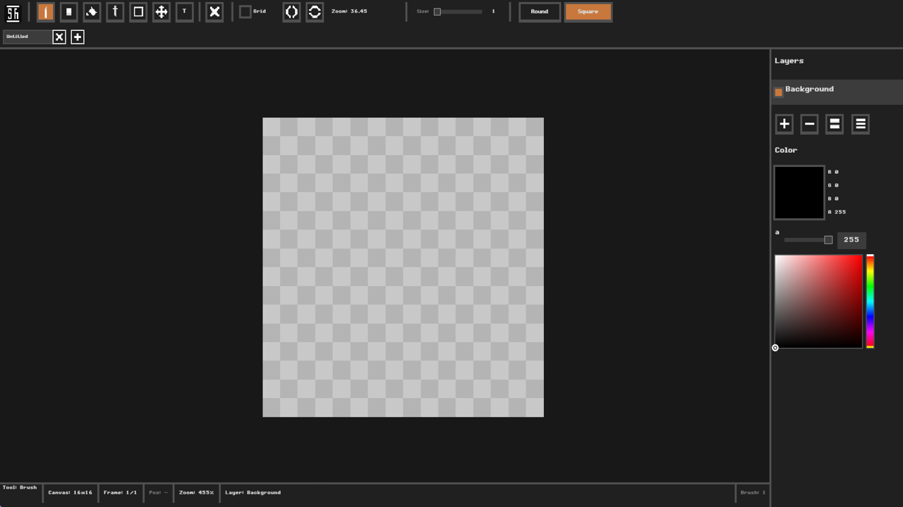

# Pixesh

A minimal pixel art editor built with Rust and egui.



## Install

Version 0.1.0. Prebuilt binaries are attached to the
[GitHub releases](https://github.com/EnotCoder/pixesh/releases/latest) page.

**Linux** — one command, installs into `~/.local/bin`:

```bash
curl -fLo ~/.local/bin/pixesh \
  https://github.com/EnotCoder/pixesh/releases/latest/download/pixesh-linux-x86_64 \
  && chmod +x ~/.local/bin/pixesh
```

Needs GTK 3 at runtime (for the native file dialogs); everything else is
already in the binary — icons and the font are embedded.

**Windows** — PowerShell:

```powershell
irm https://github.com/EnotCoder/pixesh/releases/latest/download/pixesh-windows-x86_64.zip -OutFile pixesh.zip; Expand-Archive pixesh.zip -Force
```

The executable links only system DLLs, so nothing has to be installed
alongside it.

Both URLs always resolve to the newest release, so re-running the same
command is also how you update.

## Features

- **Drawing tools** — Brush, Eraser, Fill, Eyedropper, Select, Move, Text, Transform
- **Brush shapes** — Round / Square mask (toolbar size slider + shape buttons)
- **Effects panel** — 17 effects ported from [Pixelorama](https://github.com/Orama-Interactive/Pixelorama), with a live preview — see [Effects](#effects)
- **Layers** — Add / remove / duplicate / flatten, rename (double-click), per-layer visibility
- **Animation** — Add / duplicate / delete frames, reorder with `<` and `>`, play-pause with an FPS setting
- **Selection** — Rectangular marquee, delete contents, crop the canvas to the selection
- **Copy / Paste** — `Ctrl+C` / `Ctrl+V` (or `Y` / `P`); the pasted block lands offset from the source and can be dragged into place before you commit it with `Enter`
- **HSV color picker** — Saturation/Value field + Hue strip
- **Canvas resize / scale** — Change dimensions or scale the image
- **Text tool** — Stamp text onto the canvas with the built-in font
- **Export PNG** — Save your artwork (scale x1–x16, background: none/white/black/checker)
- **Open images** — `Ctrl+L` file dialog, or drag files straight from your file manager onto the window; each file opens as its own tab
- **Welcome dialog** — Quick-start window at launch (New / Open / canvas presets), "show on startup" is remembered between runs
- **Resizable timeline** — Drag the top edge of the animation strip upward to make it taller
- **Rearrangeable panels** — Drag a panel by its grip handle to another window edge, the way you move areas in Blender — see [Layout](#layout)
- **Layout is remembered** — Panel visibility, panel sizes, window size and position, plus the brush, active tool, colour and slider settings, all come back on the next launch
- **Grid overlay** — Toggle pixel grid
- **Zoom & pan** — Scroll to zoom, arrows/middle-mouse to pan
- **Zoom to fit** — Auto-zoom on image load
- **Mirror** — Flip active layer horizontally/vertically with toolbar buttons
- **Undo / Redo** — Ctrl+Z / Ctrl+Shift+Z (up to 50 steps)
- **Multi-document tabs** — Open multiple images, Ctrl+Tab to switch
- **Toggleable panels** — Hide the toolbar, layers, status bar or timeline to get the canvas out of the way (`Ctrl+W`)

## Controls

### Tools

| Key | Action |
|-----|--------|
| `B` | Brush |
| `E` | Eraser |
| `F` | Fill (flood fill) |
| `R` | Rectangular select |
| `M` | Move (selection or canvas) |
| `T` | Text |
| `S` | Transform (needs a selection) |
| `Y` | Copy selection to clipboard |
| `P` | Paste clipboard (lands offset from the selection, or centred) |
| `Alt` (hold) | Eyedropper (temporary) |
| `Right-click + drag` | Eraser |

### Color

| Key | Action |
|-----|--------|
| `W` | Darken color |
| `.` | Brighten color |
| `A` | Decrease opacity |
| `D` | Increase opacity |

### Selection

| Key | Action |
|-----|--------|
| `Ctrl+C` | Copy selection to clipboard |
| `Ctrl+V` | Paste clipboard |
| `Enter` | Commit pasted pixels / crop canvas to selection |
| `Delete` | Delete selected pixels |
| `Escape` | Cancel paste, deselect, close dialogs |

### Animation

| Key | Action |
|-----|--------|
| `[` | Previous frame |
| `]` | Next frame |
| `Space` | Play / pause |

### Navigation

| Key | Action |
|-----|--------|
| `Scroll` | Zoom in/out |
| `Shift+Scroll` | Brush size |
| `Arrow keys` | Pan canvas |
| `Shift+Arrow` | Pan canvas (4x speed) |
| `Middle mouse drag` | Pan canvas |

### File & Dialogs

| Key | Action |
|-----|--------|
| `Ctrl+S` | Export PNG dialog |
| `Ctrl+L` | Load image (opens in new tab) |
| `Ctrl+R` | Resize canvas dialog |
| `Ctrl+I` | Scale canvas dialog |
| `Ctrl+H` | Settings dialog |
| `Ctrl+W` | Toggle panels visibility |
| `Ctrl+Shift+E` | Effects panel |
| `Ctrl+Shift+F` | Flatten layers |
| `Ctrl+D` | Deselect |
| `Ctrl+Tab` | Switch to next tab |
| `Ctrl+Z` | Undo |
| `Ctrl+Shift+Z` | Redo |
| `G` | Toggle grid |

## Layout

The toolbar, status bar, timeline and layers panel can be dragged to a
different edge of the window by the small grip at the start of each panel.
While you drag, the eligible edges light up; drop on one of them.

Each panel is only offered the edges that suit its content:

| Panel | Edges |
|-------|-------|
| Toolbar, Status bar, Timeline | Top, Bottom |
| Layers panel | Left, Right |

The toolbar, status bar and timeline are horizontal strips; the layers panel
is a vertical list with a colour picker in it. Letting the frame strip hug
the side of the window would produce a narrow unusable column, so the
timeline is never offered a side edge and the layers panel never a top or
bottom one.

Panels share an edge in a fixed order that does not depend on where you have
moved them, so they do not swap places every time you drag one. Sizing a
panel is separate from moving it: drag the panel's *outer* edge to resize,
its grip to move.

Panels are hidden and shown from the `Ctrl+W` dialog. Dialogs themselves
(resize, export, effects, settings, text, welcome) always start closed.

### Where the layout is stored

Everything above is written to a single file and restored on the next launch:

- Linux: `~/.local/share/pixesh/app.ron`
- Windows: `%APPDATA%\pixesh\data\app.ron`

It is written every 10 seconds and on exit, so a crash can lose the last few
seconds. The file is plain RON and safe to read, though not intended to be
hand-edited — values outside the ranges the UI allows are clamped on load,
and an unreadable file simply falls back to defaults.

Panel **sizes** and the window geometry live in that same file, but under keys
that egui owns (`egui` and `window`) rather than the app's own
(`pixesh_prefs`): the arrangement (which edge each panel sits on), panel
visibility, brush, tool, colour and the arrow/zoom speed settings.

Dialog flags are deliberately not stored, otherwise a dialog would reopen by
itself on the next start.

## Effects

`Ctrl+Shift+E` (or the sparkle button in the toolbar) opens the effects panel.
Effects respect the current selection — with a marquee active, only pixels
inside it are touched. The preview updates live as you drag a slider, and
**Apply** writes the result to the active layer or to every layer / every
frame, depending on the toggles. Nothing is recorded in the undo history
unless the pixels actually change.

The list and the per-effect parameters are ported from
[Pixelorama](https://github.com/Orama-Interactive/Pixelorama)'s Effects menu,
but the GLSL shaders are reimplemented as plain CPU code — no GPU shader
compilation is involved, so effects behave identically everywhere.

| Category | Effects |
|----------|---------|
| **Transform** | Offset & Scale, Mirror Image, Rotate Image, Flat to Isometric |
| **Color** | Invert Colors, Desaturation, Adjust Hue/Sat/Value, Adjust Brightness/Contrast, Color Curves, Palettize, Posterize, Gradient Map |
| **Procedural** | Outline, Drop Shadow, Gradient |
| **Blur** | Pixelize, Gaussian Blur |

Two effects are deliberately not pixel-identical to Pixelorama:

- **Palettize** builds its palette from the image being filtered (median cut)
  instead of relying on a fixed or externally supplied palette.
- **Color Curves** is exposed as a per-channel gamma plus black/white points.
  Pixelorama uses an interactive curve editor, which has no equivalent in a
  parameter list.

## Build

```bash
cargo build --release
```

Run with:

```bash
./target/release/pixesh
```

### Linux dependencies

The binary links against GTK 3 (for the native Open/Save dialogs) and the usual
X11/Wayland graphics stack. On Debian/Ubuntu:

```bash
sudo apt install libgtk-3-0 libx11-6 libx11-xcb1 libxcb1 \
    libxkbcommon0 libwayland-client0 libopengl0
```

Rendering itself does not need GTK — only the file dialogs do.

### Windows (cross-compiled from Linux)

Requires the `x86_64-pc-windows-gnu` target and mingw-w64:

```bash
rustup target add x86_64-pc-windows-gnu
CARGO_TARGET_X86_64_PC_WINDOWS_GNU_LINKER=x86_64-w64-mingw32-gcc \
    cargo build --release --target x86_64-pc-windows-gnu
```

The resulting `pixesh.exe` imports system DLLs only — no mingw runtime DLLs
need to be shipped alongside it. All icons and the font are embedded via
`include_bytes!`, so the executable is self-contained on a clean Windows
10/11.

## Project Structure

- `src/main.rs` — Entry point; the Windows build is marked GUI so no console window appears
- `src/lib.rs` — Library entry point (`run_native_app`), embeds the font, sets up visuals
- `src/app/` — Core application logic
  - `mod.rs` — App state (layers, color, tools, undo, selection, multi-doc tabs), file opening, drag-and-drop
  - `canvas.rs` — Compositing, pixel painting, Bresenham lines, flood fill, mirror
  - `anim.rs` — Per-frame compositing
  - `history.rs` — Undo/redo with snapshots
  - `input.rs` — Keyboard shortcuts, zoom, pan, copy/paste
  - `io.rs` — Save/load PNG, open image by path, layer management, canvas resize/scale/crop
  - `effects.rs` — The 17 Pixelorama effects (CPU implementations)
  - `text.rs` — Text stamping helpers
  - `config.rs` — Persisted preferences: panel visibility and edges, brush, tool, colour, slider settings
  - `panel_canvas.rs` — Canvas rendering, tool dispatch
  - `panel_drag.rs` — Dragging panels between window edges: grip handle, drop zones
  - `panel_dialogs/` — Effects, Export, Panels, Resize, Scale, Settings, Text, Welcome dialogs
  - `panel_layers.rs` — Layers panel, HSV color picker
  - `panel_status.rs` — Status bar, including transient hints
  - `panel_timeline.rs` — Resizable animation strip
  - `panel_toolbar.rs` — Toolbar with tool icons, grid toggle, tab bar
  - `tools.rs` — Tool handlers (brush, fill, eyedropper, selection, move, paste)
- `src/color.rs` — HSV <-> RGB conversion
- `src/constants.rs` — Colors, sizes, Tool enum
- `src/ui.rs` — Custom widgets (button, icon button, checkbox, slider)
- `tex/` — Tool icons
- `img/` — Screenshots
