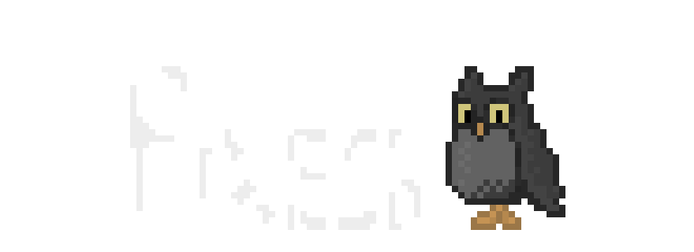

# Pixesh



A minimal pixel art editor built with Rust and egui.

## Install

Version 0.1.0 — grab an archive from the
[releases page](https://github.com/EnotCoder/pixesh/releases/latest):

| Platform | File |
|----------|------|
| Linux x86-64 | `pixesh-0.1.0-linux-x86_64.zip` |
| Windows x86-64 | `pixesh-0.1.0-windows-x86_64.zip` |

Unpack and run `pixesh` / `pixesh.exe`. Icons and the font are embedded in the
binary, and the Windows build links only system DLLs. On Linux you need
**GTK 3** at runtime, and only for the file dialogs:
`sudo apt install libgtk-3-0`.

## Features

- **Tools** — Brush, Eraser, Fill, Eyedropper, Select, Move, Text, Transform,
  with round or square brush shapes
- **Effects** — 17 effects ported from
  [Pixelorama](https://github.com/Orama-Interactive/Pixelorama), with a live
  preview; see [Effects](#effects)
- **Animation** — add, duplicate and reorder frames, play-pause with an FPS
  setting, per-layer cels
- **Layers** — add, remove, duplicate, flatten, rename, per-layer visibility
- **Selection** — rectangular marquee, copy/paste, delete, crop the canvas to
  the selection
- **Editing** — resize or scale the canvas with an optional aspect-ratio lock,
  text tool, mirror, grid overlay, HSV picker, zoom and pan, zoom-to-fit
- **Rearrangeable layout** — drag panels between window edges, resize them,
  hide them; the arrangement and your settings come back on the next launch
- **Files** — open with `Ctrl+L` or by dropping files onto the window (each
  becomes its own tab), multi-document tabs, PNG export with scale and
  background options
- **History** — undo / redo, up to 50 steps

## Controls

| Key | Action |
|-----|--------|
| `B` `E` `F` | Brush, Eraser, Fill |
| `R` `M` `T` `S` | Select, Move, Text, Transform (needs a selection) |
| `Alt` (hold) | Eyedropper |
| `Right-click + drag` | Eraser |
| `W` `.` | Darken / brighten the colour |
| `A` `D` | Decrease / increase opacity |
| `Ctrl+C` `Ctrl+V` | Copy / paste selection — `Y` and `P` do the same |
| `Enter` | Commit pasted pixels, otherwise crop to the selection |
| `Delete` / `Escape` | Delete selection / cancel paste, deselect, close dialogs |
| `[` `]` `Space` | Previous / next frame, play-pause |
| `Scroll` / `Shift+Scroll` | Zoom / brush size |
| `Arrows`, `Shift+Arrows` | Pan canvas (`Shift` = 4x speed) |
| `Middle mouse drag` | Pan canvas |
| `Ctrl+S` / `Ctrl+L` | Export PNG / open image in a new tab |
| `Ctrl+R` / `Ctrl+I` | Resize / scale canvas |
| `Ctrl+W` | Panels dialog — show, hide and arrange panels |
| `Ctrl+Shift+E` | Effects panel |
| `Ctrl+Shift+F` | Flatten layers |
| `Ctrl+H` / `Ctrl+D` | Settings / deselect |
| `Ctrl+Tab` | Next tab |
| `Ctrl+Z` / `Ctrl+Shift+Z` | Undo / redo |
| `G` | Toggle grid |

## Effects

`Ctrl+Shift+E` (or the sparkle button) opens the panel. Effects respect the
active selection, preview live while you drag a slider, and can be applied to
every layer or every frame. Nothing enters the undo history unless pixels
actually change.

| Category | Effects |
|----------|---------|
| **Transform** | Offset & Scale, Mirror Image, Rotate Image, Flat to Isometric |
| **Color** | Invert Colors, Desaturation, Adjust Hue/Sat/Value, Adjust Brightness/Contrast, Color Curves, Palettize, Posterize, Gradient Map |
| **Procedural** | Outline, Drop Shadow, Gradient |
| **Blur** | Pixelize, Gaussian Blur |

Ported from Pixelorama; the GLSL shaders are reimplemented as plain CPU code,
so they behave identically everywhere. Two are deliberately not identical to
the originals: **Palettize** builds its palette from the image itself (median
cut), and **Color Curves** is a per-channel gamma plus black/white points
rather than an interactive curve editor.

## Layout

Drag a panel by the small grip at its start onto another window edge — the
eligible edges light up while you drag. Toolbar, status bar and timeline move
only between top and bottom, the layers panel only between left and right,
since they are shaped differently. Drag a panel's *outer* edge to resize it.

Everything is kept in one file — `~/.local/share/pixesh/app.ron` on Linux,
`%APPDATA%\pixesh\data\app.ron` on Windows — written every 10 seconds and on
exit. Dialogs are never restored, so nothing opens by itself.

## Build

```bash
cargo build --release
./target/release/pixesh
```

Windows can be cross-compiled from Linux:

```bash
rustup target add x86_64-pc-windows-gnu
CARGO_TARGET_X86_64_PC_WINDOWS_GNU_LINKER=x86_64-w64-mingw32-gcc \
    cargo build --release --target x86_64-pc-windows-gnu
```

Architecture and internals are documented in
[docs/ARCHITECTURE.md](docs/ARCHITECTURE.md).